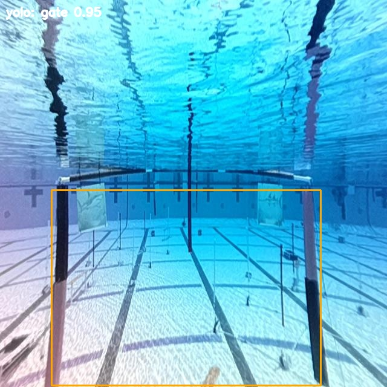
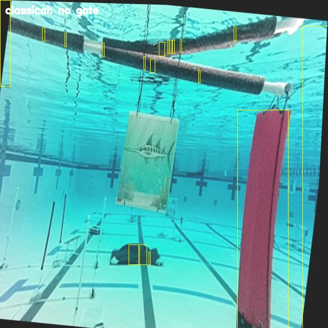
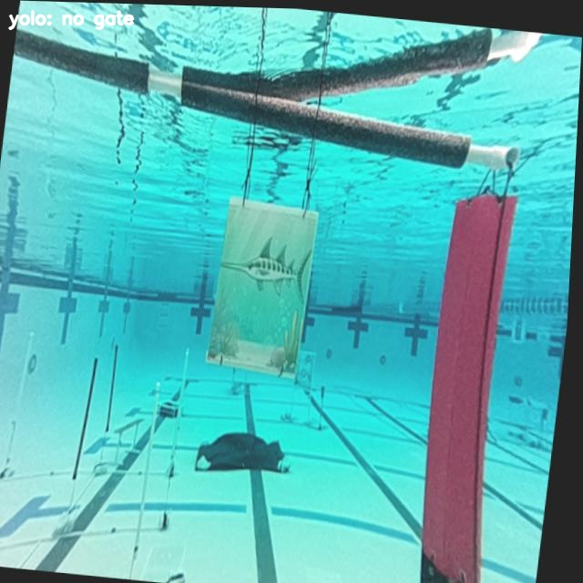
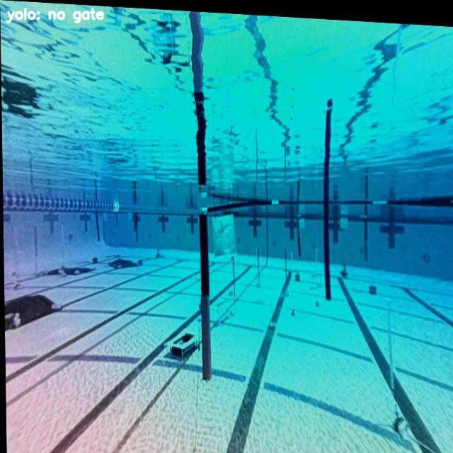
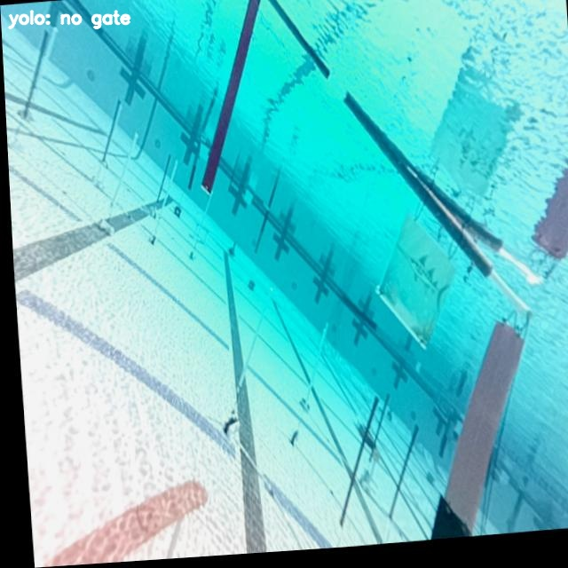
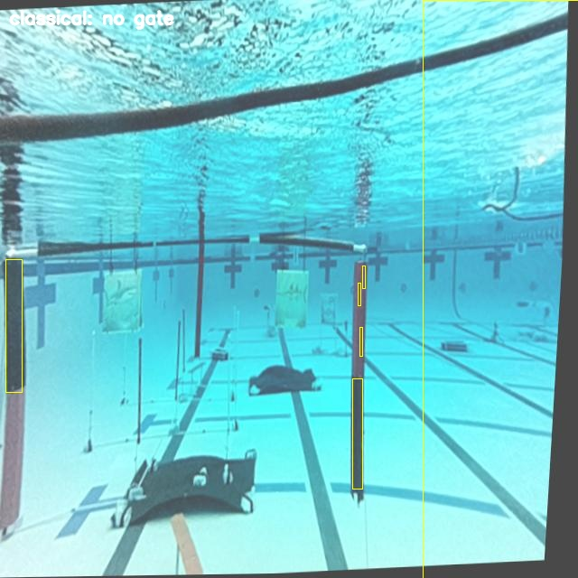
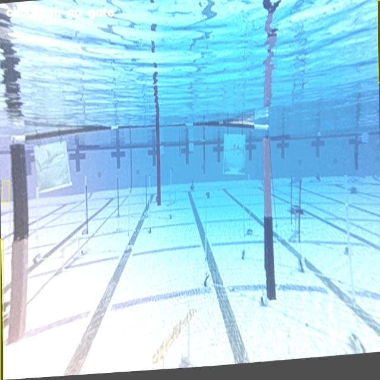
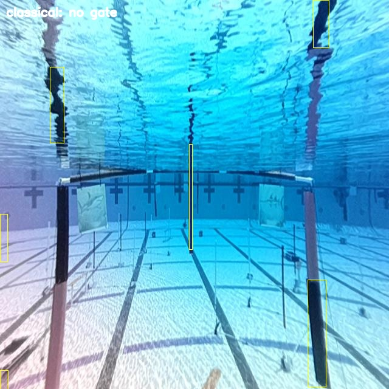

# Failure Analysis

## Three failure modes: 
- Classical on cut-off gates
- Classical on washed-out photos
- YOLO on zoomed-in photos (No other issues w/ YOLO; I'm operating under the assumption that it doesn't have false-positives because the original images were mislabeled after manually looking through the annotations)

## Accuracy vs speed: 
- mAP50 0.906 vs 0.089, FPS 28 vs 796 (not taking into consideration hardware caveat)

## Training-data coverage and YOLO: 
- It learned from 1,467 images (274 with no gate). 
- If zoomed-in photos are rare in training, that would explain why they fail. Check that with the manifest before you claim it. Also mention the leakage risk.

## Classical Failures
- When both posts visible, 
- Reflection of posts still causing issues
- Dull colors, grainy photos, etc

## What to improve next
- YOLO seems to only be struggling with zoomed-in training photos, implementing a solution on those photos will make the accuracy near perfect
- Training YOLO on a data without leakage

## Side-by-side comparison

| Classical | YOLO |
|---|---|
|  |  |
*(Classical fails, Yolo detects the gate)*
|  |  |
*(Both Yolo and Classical fail here)*

### YOLO failures

*The photo is so zoomed in that the gate fills the frame and YOLO misses it.*

*Gate is too far away for YOLO to detect it*

*Right post in frame but YOLO misses it, possibly because it's too zoomed in*

## Classical failures

*Missed, new classical method is very buggy*

*Miss, detecting random black edges as too small for there to be a gate..*

*Miss, detected reflection blobs instead of the post..*

